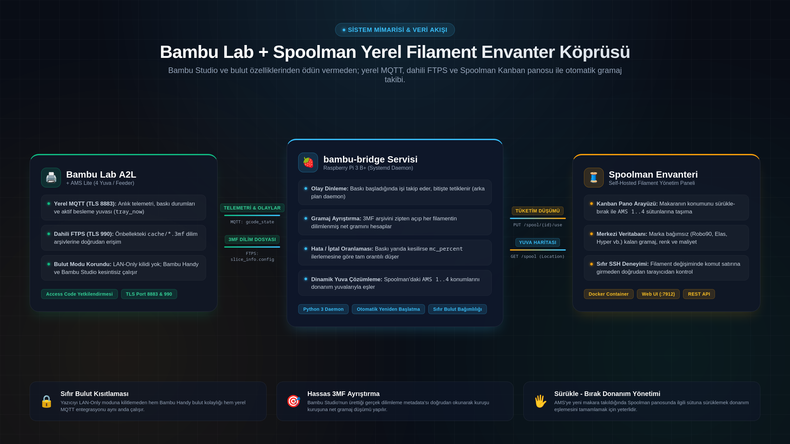

# Bambu Lab -> Spoolman Automatic Filament Tracking Bridge 🧵🖨️

[](LICENSE)
[](https://www.python.org/)
[](https://mqtt.org/)
[](https://en.wikipedia.org/wiki/FTPS)
[](docker-compose.yml)

A lightweight, self-hosted integration bridge that **automatically tracks generic / third-party filament usage** on **Bambu Lab 3D printers** (A-series, P-series, X-series + AMS / AMS Lite) and syncs directly with [Spoolman](https://github.com/Donkie/Spoolman).

> 🌍 *[Türkçe Kurulum ve Kullanım Kılavuzu için buraya tıklayın](#-türkçe-kılavuz)*

---



---

## 🌟 Key Features

- **🔒 Zero Cloud Lockout (Cloud-Safe):** Works concurrently with standard Bambu Cloud mode! You **do not** need to lock your printer into offline LAN-Only mode. Bambu Handy mobile app and Bambu Studio cloud sending remain 100% operational.
- **🎯 Precise Sliced Gram Parsing:** Directly inspects the sliced `.3mf` package cached on the printer via internal FTPS (`Metadata/slice_info.config`) to read exact per-filament gram consumption.
- **🖐️ Drag-and-Drop Slot Mapping:** Map your physical AMS slots directly through Spoolman's web Kanban dashboard. Drag a spool into `AMS 1`, `AMS 2`, `AMS 3`, or `AMS 4` columns — the bridge detects the change dynamically. **Zero CLI or SSH required.**
- **⚖️ Smart Fractional Deduction:** If a print is cancelled or fails mid-way, filament usage is scaled proportionally based on the actual progress percentage (`mc_percent`).
- **🍓 Extremely Lightweight:** Runs as a tiny Python daemon or Docker container on any Raspberry Pi (tested on Raspberry Pi 3 B+) or home server.

---

## 🏗️ How It Works

1. **Telemetry via MQTT (Port 8883 / TLS):** Connects to the printer's local broker using the printer's local access code. Monitors print lifecycle (`RUNNING`, `FINISH`, `FAILED`) and active AMS feeder tray (`tray_now`).
2. **Gramage via FTPS (Port 990 / TLS):** When a print completes, the bridge accesses the printer's local cache over implicit FTPS, opens the `.3mf` archive, and reads the exact slicer filament weights for the printed plate.
3. **Dynamic Slot Resolution:** Matches slicer filaments to physical AMS slots (`mapping` / `tray_now`), checks which spool in Spoolman currently holds location `AMS 1..4`, and deducts the exact weight via Spoolman's REST API (`PUT /api/v1/spool/{id}/use`).

---

## 🚀 Quick Start

### 1. Requirements

- Python 3.10+ (or Docker)
- A running [Spoolman](https://github.com/Donkie/Spoolman) instance
- A Bambu Lab printer with AMS / AMS Lite connected to the same local network

### 2. Find Your Printer Credentials

On your printer touch screen:
- **IP Address:** Go to `Settings` -> `WLAN / Network` (e.g. `192.168.1.100`).
- **Access Code:** Go to `Settings` -> `WLAN` -> `LAN Only` section. Note the 8-character code (you do **not** need to enable LAN-Only mode, the code is visible there).
- **Serial Number:** Go to `Settings` -> `Device` (e.g. `0309...` or `26A19...`).

---

### Option A: Running as a Systemd Service (Raspberry Pi / Linux)

1. Clone this repository:
   ```bash
   git clone https://github.com/Yarasarda/bambu-spoolman-bridge.git
   cd bambu-spoolman-bridge
   ```

2. Install dependencies:
   ```bash
   pip3 install -r requirements.txt
   ```

3. Create the environment configuration file (e.g. `/etc/bambu-bridge.env`):
   ```bash
   sudo cp .env.example /etc/bambu-bridge.env
   sudo nano /etc/bambu-bridge.env
   ```
   Fill in your printer IP, Serial Number, Access Code, and Spoolman URL.

4. Install and enable the systemd service:
   ```bash
   sudo cp bambu-bridge.service /etc/systemd/system/
   sudo systemctl daemon-reload
   sudo systemctl enable --now bambu-bridge
   ```

5. Check status and logs:
   ```bash
   sudo systemctl status bambu-bridge
   journalctl -u bambu-bridge -f
   ```

---

### Option B: Docker Compose

1. Clone the repository and navigate into the folder:
   ```bash
   git clone https://github.com/Yarasarda/bambu-spoolman-bridge.git
   cd bambu-spoolman-bridge
   ```

2. Copy `.env.example` to `.env` and fill in your values:
   ```bash
   cp .env.example .env
   nano .env
   ```

3. Start both Spoolman and the Bridge:
   ```bash
   docker compose up -d
   ```

---

## 🎛️ Managing AMS Slots in Spoolman

No SSH or config file editing required:

1. Open your Spoolman Web UI (`http://<server-ip>:7912`).
2. Go to **Dashboard** and set grouping to **Location** (Konum).
3. Whenever you load a spool into your AMS / AMS Lite:
   - Drag the spool card into the corresponding column: **`AMS 1`**, **`AMS 2`**, **`AMS 3`**, or **`AMS 4`**.
   - When unloading, drag it back to **Unassigned** (or set location to `Storage`, `Box`, etc.).

The bridge automatically fetches updated locations on every print cycle.

### Multiple AMS units and AMS HT (v0.2)

Location names the bridge understands (case-insensitive):

| Hardware | Spoolman location |
|---|---|
| AMS / AMS Lite, first unit, slot 1-4 | `AMS 1` … `AMS 4` *(unchanged from v0.1)* |
| Second AMS unit, slot 3 | `AMS 2-3` (unit `-` slot, up to `AMS 4-4`) |
| AMS HT | `AMS HT` (a second HT: `AMS HT 2`, …) |

You can also assign from the CLI: `python3 slot.py "AMS HT" 7` or `python3 slot.py "AMS 2-3" 5`.

> ⚠️ **Test status.** v0.1 behaviour (single AMS / AMS Lite) is verified on a real **Bambu Lab A2L + AMS Lite**.
> Multiple-AMS and **AMS HT** support is implemented from the printer's documented MQTT/tray numbering
> (AMS `0-15`, AMS HT `128+`) and covered by unit tests, but the author has **no AMS HT / second AMS to test with**.
> If you have one, please run the diagnostic below and open an issue with the output. Thank you!

```bash
python3 bridge.py --dump     # needs the same PRINTER_* env vars as the service
```

It prints the AMS units/trays your printer reports, the tray numbers the bridge derives from them, and which Spoolman spool is assigned to each slot.

---

## 🖥️ Running on Proxmox (LXC)

The bridge is a single small Python process, so an unprivileged **Debian 12/13 LXC** is plenty (reported working by a community user). You do not need Docker inside the container.

```bash
# inside the LXC (as root)
apt update && apt install -y python3 python3-paho-mqtt git
git clone https://github.com/Yarasarda/bambu-spoolman-bridge.git /opt/bambu-bridge
cd /opt/bambu-bridge

cp .env.example /etc/bambu-bridge.env && nano /etc/bambu-bridge.env
chmod 600 /etc/bambu-bridge.env

# adjust the unit for root + /opt path, then enable it
sed -e 's#^User=.*#User=root#' \
    -e 's#/home/pi/bambu-bridge#/opt/bambu-bridge#g' \
    bambu-bridge.service > /etc/systemd/system/bambu-bridge.service
systemctl daemon-reload && systemctl enable --now bambu-bridge
journalctl -u bambu-bridge -f
```

Notes:
- `SPOOLMAN_URL` in the env file must point to wherever Spoolman runs (another LXC/VM is fine), e.g. `http://192.168.1.20:7912/api/v1`.
- The LXC must be on the same network/VLAN as the printer (MQTT `8883` and FTPS `990` are used).
- Prefer a dedicated user over `root` if you like: create one, `chown` the folder, and keep `User=` in the unit.

---

<br>

---

## 🇹🇷 Türkçe Kılavuz

Bambu Lab 3D yazıcılarında (A serisi, P serisi, X serisi + AMS / AMS Lite) üçüncü parti (generic) markasız filament kullandığınızda, makaralarda RFID çipi bulunmadığı için Bambu Studio kalan filament miktarını takip edemez.

Bu köprü servisi, yazıcının yerel MQTT ve FTPS arayüzlerini dinleyerek baskı bittiğinde harcanan net gramajı [Spoolman](https://github.com/Donkie/Spoolman) envanterinizden **otomatik olarak düşer**.

### 🌟 Öne Çıkan Özellikler

- **Bulut Modu Korunur:** Yazıcıyı LAN-Only moduna kilitlemeniz gerekmez. Bambu Handy mobil uygulaması ve Bambu Studio bulut üzerinden baskı gönderme özellikleri kesintisiz çalışmaya devam eder.
- **Gerçek Dilimleme Verisi:** Yazıcının dahili önbelleğindeki `.3mf` paketini FTPS üzerinden okur (`slice_info.config`) ve her filament için dilimleyicinin hesapladığı net gramajı çeker.
- **Sürükle - Bırak Yuva Yönetimi:** Spoolman web panosunda makarayı `AMS 1`, `AMS 2`, `AMS 3`, `AMS 4` sütununa sürüklemeniz yeterlidir. Donanım yuva eşlemesi anında güncellenir, SSH ile komut satırına girmeniz gerekmez.
- **İptal ve Hata Oranlaması:** Baskı iptal edilirse veya yarıda kalırsa, ilerleme yüzdesine (`mc_percent`) göre harcanan filament orantılı olarak düşülür.
- **Hafif Mimari:** Raspberry Pi 3 B+ gibi düşük donanımlarda bile arka planda minimum kaynak tüketimiyle çalışır.

### ⚙️ Hızlı Kurulum

1. Depoyu klonlayın:
   ```bash
   git clone https://github.com/Yarasarda/bambu-spoolman-bridge.git
   cd bambu-spoolman-bridge
   ```
2. Gereksinimleri yükleyin:
   ```bash
   pip3 install -r requirements.txt
   ```
3. Yazıcı bilgilerinizi hazırlayın:
   - **IP Adresi:** Yazıcı ekranı > Ayarlar > WLAN / Ağ
   - **Access Code:** Yazıcı ekranı > Ayarlar > WLAN > LAN Only sekmesindeki 8 haneli kod
   - **Seri Numarası:** Yazıcı ekranı > Ayarlar > Cihaz
4. `.env.example` dosyasını `/etc/bambu-bridge.env` olarak kopyalayıp bilgilerinizi girin:
   ```bash
   sudo cp .env.example /etc/bambu-bridge.env
   sudo nano /etc/bambu-bridge.env
   ```
5. Systemd servisini başlatın:
   ```bash
   sudo cp bambu-bridge.service /etc/systemd/system/
   sudo systemctl daemon-reload
   sudo systemctl enable --now bambu-bridge
   ```

Logları canlı takip etmek için:
```bash
journalctl -u bambu-bridge -f
```

### 🆕 v0.2: Birden fazla AMS ve AMS HT

Spoolman'daki **Konum** alanına şunları yazabilirsiniz (büyük/küçük harf fark etmez):

| Donanım | Konum |
|---|---|
| İlk AMS / AMS Lite, yuva 1-4 | `AMS 1` … `AMS 4` *(v0.1 ile aynı)* |
| İkinci AMS ünitesi, 3. yuva | `AMS 2-3` (ünite-yuva, en fazla `AMS 4-4`) |
| AMS HT | `AMS HT` (ikinci HT için `AMS HT 2`) |

> ⚠️ **Test durumu:** Tek AMS / AMS Lite gerçek bir **Bambu Lab A2L + AMS Lite** üzerinde doğrulandı. Çoklu AMS ve **AMS HT** desteği yazıcının tepsi numaralandırmasına göre yazıldı ve birim testleriyle kapsandı, ancak geliştiricinin elinde AMS HT / ikinci AMS **yok**. Sizde varsa `python3 bridge.py --dump` çıktısını bir issue olarak paylaşırsanız çok yardımcı olur.

### 🖥️ Proxmox LXC üzerinde çalıştırma

Köprü tek bir küçük Python süreci olduğu için Debian 12/13 LXC yeterlidir, Docker gerekmez. Adımlar için yukarıdaki İngilizce **"Running on Proxmox (LXC)"** bölümüne bakın. Özet: `apt install python3 python3-paho-mqtt git`, depoyu `/opt/bambu-bridge`'e klonla, `/etc/bambu-bridge.env` dosyasını doldur, servisi etkinleştir. `SPOOLMAN_URL` Spoolman'ın çalıştığı adresi göstermelidir.

## 🧵 Companion App / Eşlikçi Uygulama

**[Filament Tray](https://github.com/Yarasarda/filament-tray)**: a cross-platform (Windows / macOS / Linux) system tray app that shows remaining filament per AMS slot (hover or click), with low-filament notifications. It reads the same `AMS 1..4` Spoolman locations this bridge uses.
*Filament Tray: AMS yuvalarındaki kalan filamenti sistem tepsisinde gösteren çok platformlu uygulama. Köprüyle aynı `AMS 1..4` konumlarını okur.*

---

## 🙏 Acknowledgements / Teşekkürler

- **[u/M346ZCP](https://www.reddit.com/user/M346ZCP)** on Reddit: first community user of the bridge, ran it in a Proxmox LXC, and suggested **AMS HT support**, which led to v0.2 (multi-AMS / AMS HT slots and the LXC guide).
  *Reddit'ten u/M346ZCP: köprüyü ilk deneyen topluluk kullanıcısı. Proxmox LXC'de çalıştırdı ve AMS HT desteğini önerdi; v0.2 bu öneriyle ortaya çıktı.*
- [Spoolman](https://github.com/Donkie/Spoolman) by Donkie, the inventory backend this project builds on.

## 📄 License

This project is licensed under the MIT License - see the [LICENSE](LICENSE) file for details.
